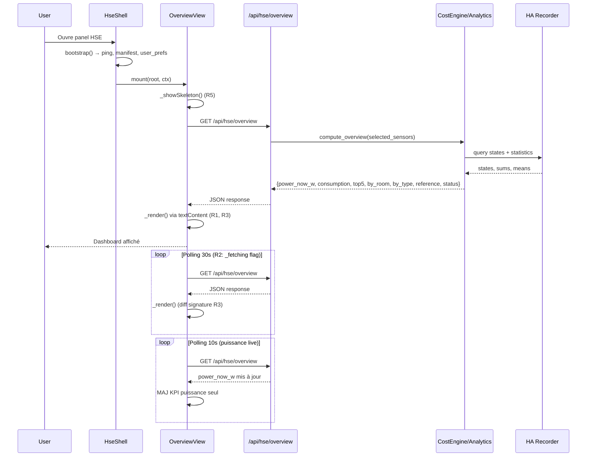
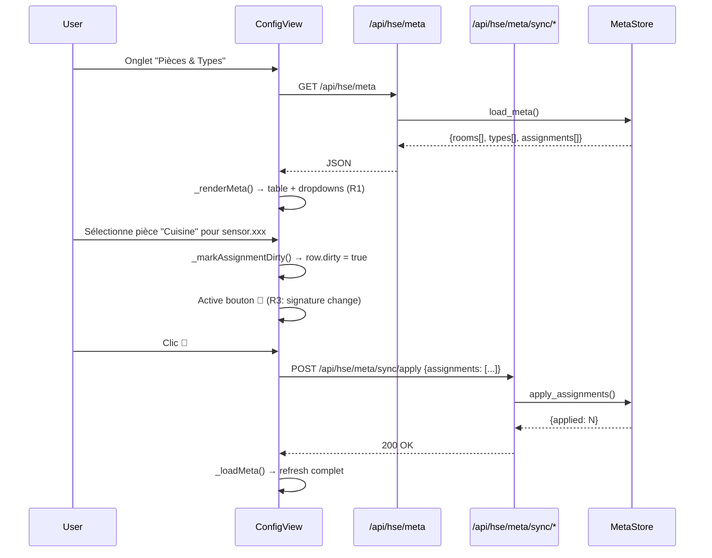
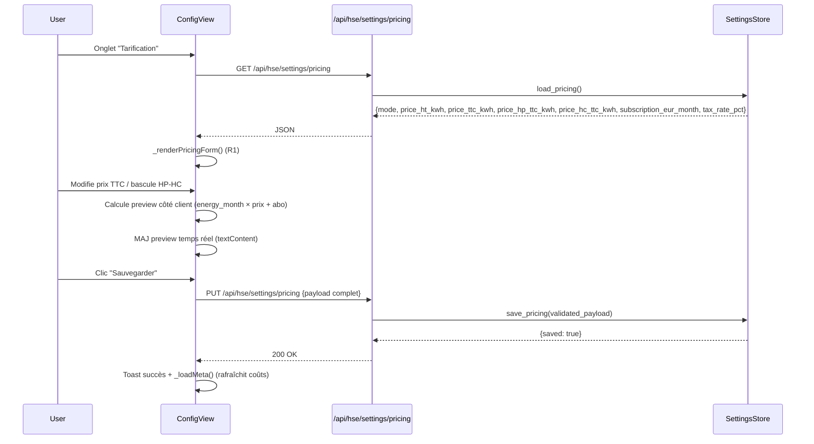
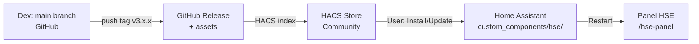

# Architecture HSE V3 — Diagramme Mermaid

## Vue d'ensemble système

```mermaid
flowchart TB
    subgraph HA["Home Assistant Core"]
        REC["Recorder\n(historique long terme)"]
        ER["Entity Registry\n(entités HA)"]
        ST["Storage HA\n(.storage/)"]
        CF["Config Flow\n(intégration)"]
    end

    subgraph HSE["HSE V3 Custom Integration"]
        direction TB
        API["API REST\n/api/hse/*"]
        ENG["Engine\nCostEngine, Analytics"]
        SM["StorageManager\nCatalogue, Meta, UserPrefs"]
        SV["Services HA\n8 services déclarés"]
        RP["Repairs\nAlertes natives"]
    end

    subgraph FE["Frontend JS (Vanilla, iframe)"]
        SH["HseShell\nRouting, Polling, Bootstrap"]
        V1["OverviewView\nDashboard live"]
        V2["DiagnosticView\nScore qualité"]
        V3["ScanView\nDétection + Triage"]
        V4["ConfigView\nAppareils, Pièces/Types, Tarif"]
        V5["CostsView\nCoûts + Historique + Export"]
        V6["MigrationView\nV1→V3 Wizard"]
        V7["CardsView\nYAML Composer"]
        V8["CustomView\nThème, Préférences UI"]
        UI["Shared UI\nTokens, Themes, Skeleton, Table"]
    end

    %% Connexions HA → HSE
    REC -->|states, statistics| ENG
    ER -->|entity_id, device_id| SM
    ST -->|persist/load| SM
    CF -->|setup, options| API

    %% Connexions HSE internes
    API -->|délégué| ENG
    API -->|CRUD| SM
    SV -->|appel interne| API
    RP -->|lecture| SM

    %% Connexions Frontend ↔ Backend
    SH -->|/api/hse/ping\n/api/hse/frontend_manifest\n/api/hse/user_prefs| API
    V1 -->|GET /api/hse/overview\n(polling 30s/10s)| API
    V2 -->|GET/POST /api/hse/diagnostic| API
    V3 -->|GET /api/hse/scan\nPOST /api/hse/catalogue/*| API
    V4 -->|GET /api/hse/catalogue\nGET/POST /api/hse/meta\nGET/PUT /api/hse/settings/pricing| API
    V5 -->|GET /api/hse/costs\nGET /api/hse/history\nGET /api/hse/export| API
    V6 -->|GET/POST /api/hse/migration| API
    V7 -->|GET /api/hse/catalogue| API
    V8 -->|GET/PATCH /api/hse/user_prefs| API

    %% Frontend interne
    SH -->|mount/unmount| V1
    SH -->|mount/unmount| V2
    SH -->|mount/unmount| V3
    SH -->|mount/unmount| V4
    SH -->|mount/unmount| V5
    SH -->|mount/unmount| V6
    SH -->|mount/unmount| V7
    SH -->|mount/unmount| V8
    V1 -.->|utilise| UI
    V2 -.->|utilise| UI
    V3 -.->|utilise| UI
    V4 -.->|utilise| UI
    V5 -.->|utilise| UI
    V6 -.->|utilise| UI
    V7 -.->|utilise| UI
    V8 -.->|utilise| UI

    %% Styles
    classDef ha fill:#f3f4f6,stroke:#6b7280,color:#1f2937;
    classDef hse fill:#dbeafe,stroke:#2563eb,color:#1e3a8a;
    classDef fe fill:#fef3c7,stroke:#f59e0b,color:#92400e;
    classDef ui fill:#ecfdf5,stroke:#10b981,color:#065f46;

    class HA,REC,ER,ST,CF ha;
    class HSE,API,ENG,SM,SV,RP hse;
    class FE,SH,V1,V2,V3,V4,V5,V6,V7,V8 fe;
    class UI ui;
```

---

## Flux de données principal (Overview)



---

## Flux Configuration — Pièces & Types (onglet Config C)



---

## Flux Tarification (onglet Config C — sous-section Tarif)



---

## Stockage — Séparation des responsabilités

```mermaid
flowchart LR
    subgraph SM[StorageManager]
        direction TB
        CAT[CatalogueStore\ncatalogue.json\n- entities[]\n- quality_score\n- status]
        MET[MetaStore\nmeta.json\n- rooms[{id,name}]\n- types[]\n- assignments[{eid,room,type,pending}]]
        USR[UserPrefsStore\nuser_prefs.json\n- active_tab\n- overview_period\n- theme, glass, bg]
        SET[SettingsStore\nsettings.json\n- pricing{mode,prices,sub,tax}\n- reference_entity_id]
    end

    API_CAT[/api/hse/catalogue*] --> CAT
    API_META[/api/hse/meta*] --> MET
    API_PREFS[/api/hse/user_prefs] --> USR
    API_SET[/api/hse/settings/pricing] --> SET

    CAT -.->|sync_engine| HA_ENT[HA Entity Registry]
    MET -.->|assignations| ENGINE[CostEngine]
    USR -.->|persist| HA_STORE[HA .storage/]
    SET -.->|tarif| ENGINE
```

---

## Règles d'architecture (invariants)

| Règle | Description | Fichier référence |
|-------|-------------|-------------------|
| **R1** | `mount()` construit le DOM **une seule fois** | `00_methode_front_commune.md` |
| **R2** | Flag `_fetching` sur **chaque** fetch (anti race) | `00_methode_front_commune.md` |
| **R3** | `JSON.stringify` signature avant `_render()` (anti re-render) | `00_methode_front_commune.md` |
| **R4** | **Zéro** `localStorage` — tout via `user_prefs` backend | `00_methode_front_commune.md` |
| **R5** | **Skeleton** posé avant premier fetch | `00_methode_front_commune.md` |
| **Séparation** | Données (stores) ≠ Rendu (vues) — pas de re-render global | `README.md`, `ROADMAP_TO_PROD.md` |
| **Auth** | Tous endpoints `requires_auth=True`, `cors_allowed=False` | `api/base.py`, `10_api_contrat.md` |
| **Validation** | Payloads stricts → 422 si invalide, pas d'acceptation silencieuse | `10_api_contrat.md` |
| **Persistance** | Via `StorageManager` uniquement, pas de JSON brut | `storage/manager.py` |
| **Assignations** | Manuelles jamais écrasées par sync (flag `pending`) | `meta/assignments.py`, `meta/sync.py` |
| **Types** | Suppression type → pas de réapparition via refs orphelines | `meta/schema.py`, `meta/sync.py` |

---

## Déploiement HACS



---

*Généré à partir du code source — Source de vérité : `custom_components/hse/`*